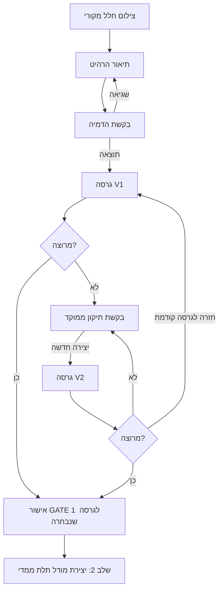

# APP-UX-002 / Phase 1 — תיקון ההדמיה ואישור גרסה

**תאריך:** 2026-11-12  
**גרסה:** DRAFT 0.2  
**משימת אב:** APP-UX-002  
**סטטוס:** UX SPECIFIED / NOT IMPLEMENTED / NOT USER TESTED  
**דוגמת פיילוט:** שידת לילה קטנה העומדת על הרצפה; בחירת עבודה ראשונית בלבד.  
**תלות:** APP-SPEC-001 + APP-UX-002_PHASE1_VISUAL_WIREFRAMES_HE.md

## 1. מטרת המסך
לאפשר ללקוח להגיע מהדמיה ראשונה לתמונה שהוא אוהב באמצעות **שינויים ממוקדים ומבוססי גרסאות**, בלי להתחיל את התהליך מחדש בכל פעם ובלי לאבד את צילום הבית המקורי.

כל הדמיה היא **הצעת עיצוב חזותית**. אין להסיק מידות מדויקות, יציבות או היתכנות ייצור מתוך התמונה בלבד. התיקון יכול להצליח חלקית בלבד; אי אפשר להבטיח ששירות AI ישנה תכונה אחת בלי להשפיע על אחרות עד שהדבר נבדק.

## 2. מסכי חוויית המשתמש

### U10 — צילום / העלאת חלל
- כותרת: "צלמו את החלל שבו תרצו להציב רהיט".
- צילום מופעל רק אחרי פעולת המשתמש והרשאה; אפשר להעלות תמונה מהגלריה.
- תמונה מוצגת מקומית לבדיקה; לפני שליחה לשרת יש הודעה על פרטיות, הסכמה והסבר על ספקי עיבוד חיצוניים.
- אפשר לצלם מחדש, לחתוך, ולנסות להסתיר פרטים אישיים.
- טיפ צילום: להראות קיר, רצפה, פתחי מעבר ונקודת ייחוס למידות. תמונה לבדה אינה מדידה הנדסית.
- CTA: "השתמשו בתמונה".

### U11 — אפיון הרהיט
- כותרת: "איזה רהיט תרצו להוסיף?".
- בחירת מוצר: בפיילוט "שידת לילה"; סוגי רהיטים נוספים לא יוצגו כנתמכים עד שקיים אימות תכנוני עבורם.
- שדות: תיאור חופשי, סגנון, גוון/גימור, מאפיינים (מגירה/מדף), רוחב/גובה/עומק אם ידועים, מגבלות נישה.
- לכל מידה מצב: `measured` = נמדדה, `estimated` = משוערת, `unknown` = לא ידועה.
- CTA: "צור הדמיה".
- לפני הרצה מרוחקת: הצגת צריכת מכסה/עלות אם רלוונטית; אין מספרי קרדיטים מומצאים.

### U12 — יצירת תמונה
- הצגת סטטוס אמיתי ללא אחוזי התקדמות מפוברקים.
- סיכום: תמונת מקור, שידת לילה, בקשת המשתמש, מזהה בקשה פנימי.
- שגיאה: מסלול ניסיון חוזר **בלי** ליצור חיוב כפול כאשר אפשר להשתמש באותו request_id/idempotency_key.
- פעולה: "חזור לעריכה".

### U13 — הדמיה מאושרת-לעתיד / תוצאות
- אזור עליון: התמונה המקורית ותמונת ההדמיה, עם מתג "לפני / אחרי".
- מתחת: בחירת גרסאות שנוצרו בפועל, עם מספר גרסה ותאריך יצירה (ללא תאריך/גרסה בדויים).
- כפתורים: "שנו את ההדמיה", "צור וריאציה", "מאשר/ת את המראה".
- הודעה קצרה: "זוהי הדמיה לצורכי עיצוב. להתאמה פיזית נדרשת מדידה".
- אישור GATE 1 יוצר אירוע אישור מוגבל לגרסה מסוימת בלבד.

### U13-E — בקשת תיקון ממוקד
לוח עריכה/שיחה המאפשר:
1. **מבנה הרהיט:** למשל "הוסף מגירה", "הסר מדף", "רגליים גבוהות יותר".
2. **מידות והיקף:** שינוי רוחב/גובה/עומק; להציג אם המידה נמדדה או רק יעד.
3. **סגנון וגימור:** למשל "גוון עץ טבעי", "מראה מינימליסטי".
4. **מיקום בחלל:** הזזה יחסית לקיר/חלון/נקודת עוגן.
5. **תיקון חופשי:** ניסוח טקסטואלי עם הצעת ניסוח ברורה.
- הצגת "מה משתנה" + "מה ננסה לשמר": צילום החדר, מבנה החדר, פריטים קיימים והיבטים אחרים של הרהיט. זהו **יעד למודל**, לא התחייבות שיישמרו ללא שינוי.
- פעולה: "צור גרסה מתוקנת".
- כל ניסיון תיקון יוצר `revision_request_id`; פלט מוצלח הוא גרסה חדשה, לא דריסה של התמונה הקודמת.
- אם בקשת שינוי לא נתמכת או המודל הזיז פרטים שלא התבקשו — הציגו אפשרות "חזור לגרסה הקודמת", ודווחו מה נכשל.

### U13-C — השוואה ואישור סופי
- שתי גרסאות: מקורית ומתוקנת, או "לפני ואחרי" של אותה גרסה, מוצגות עם תוויות חד־משמעיות.
- לאחר בחירה: דיאלוג GATE 1:
  - "בחרת הדמיה מספר [version]".
  - "האישור הוא של מראה הרהיט בתמונה בלבד".
  - "כדי לקבל מודל 3D נידרש להשלים נתונים/הנחות בגב הרהיט ובמידות".
  - כפתורים: "חזור לעריכה", "אשר והמשך לתלת־ממד".
- לא ניתן לאשר גרסה שלא נשמרה בהצלחה.

## 3. מעבר מצבים מדויק



**כלל שמירת גרסאות:** `scene_asset_id` נשאר קבוע לאורך יצירת הגרסאות, אלא אם הלקוח בחר להחליף את צילום החלל. `visual_version_id` חדש לכל תוצאה. `approved_visual_version_id` מתעדכן רק על ידי פעולה מפורשת. שינוי מאוחר יותר אינו משנה בדיעבד את תוצרי הגרסה הקודמת, אלא מחייב אישור מחדש של שרשרת תוצרים תלויים.

## 4. פרטי אירוע תיקון (חוזה נתונים מוצע בלבד)

```json
{
  "project_id": "PROJECT_ID",
  "scene_asset_id": "PRIVATE_SCENE_ID",
  "base_visual_version_id": "V1",
  "revision_request_id": "REQUEST_ID",
  "edit_scope": "object_appearance",
  "target": "nightstand",
  "instruction": "לשנות את צבע שידת הלילה לעץ בהיר",
  "preserve_requested": [
    "room_geometry",
    "existing_room_objects",
    "nightstand_position"
  ],
  "target_dimensions_mm": {
    "width": null,
    "height": null,
    "depth": null
  },
  "measurement_confidence": "unknown",
  "result_visual_version_id": "V2",
  "result_status": "PENDING"
}
```

הסכמה היא להמחשת UX והצעת חוזה API. אין כרגע שרת או שירות מחובר שמבצע את הקריאה.

## 5. החלטות תכנון מיידיות
- **נאמנות לתמונה:** להציג אפשרות השוואה מול הצילום המקורי, ולא רק גלריה של הדמיות.
- **תיקון לפני אישור:** שינויים מצטברים בגרסאות בלתי־משתנות; אפשר לחזור גרסה אחורה.
- **תיקון אחרי אישור:** יוצר ענף חדש של עיצוב; מודל 3D שנגזר מהאישור הקודם נשאר ארטיפקט היסטורי ואינו מאושר מחדש אוטומטית.
- **טקסט חופשי לצד בחירות מהירות:** לשמור על פשטות למשתמשים שאינם מכירים CAD.
- **בקרת פרספקטיבה:** אפליקציית שלב 1 מציגה מיקום חזותי משוער בלבד, לא טענה לאימות גאומטרי.
- **פרטיות:** צילום הבית אינו נשלח אוטומטית לשיתוף ציבורי או לקישור בלתי מוגן.
- **עלות:** תמחור, מכסות ומנגנון stop יוגדרו ב־APP-ARCH-003.

## 6. דוגמת מסלול בדיקה (לא הורץ)
1. העלאת צילום נישה בבית (באישור מתאים).
2. בחירה בשידת לילה קטנה עם מגירה אחת.
3. יצירת הדמיה ראשונה — V1.
4. בקשה: "החלף את הגוון לעץ טבעי בהיר, אל תשנה את החדר".
5. נוצרה V2. הלקוח רואה V1 ו־V2 זו לצד זו; ייתכנו הבדלים נוספים שיש לבחון.
6. הלקוח בוחר ב־V2 ומאשר GATE 1.
7. כל בקשה ל־3D מופנית ל־V2 ולנתוני העיצוב המתאימים.
8. חזרה ושינוי מידות אחרי האישור מחייבים גרסה ואישור חדשים.

## 7. תנאי קבלה לבדיקת UX (טרם בוצעו)
- [ ] בכל שלב קיים כפתור ברור אחד להמשך ודרך לחזור.
- [ ] העלאת תמונה מתאפשרת גם ללא הרשאת מצלמה.
- [ ] חדר המקור נותר מזהה מקור קבוע לגרסאות תיקון.
- [ ] שינוי ממוקד יוצר גרסה נפרדת, עם הבדל מתועד.
- [ ] ניתן להשוות שתי גרסאות ולחזור לגרסה קודמת.
- [ ] עדכון מידה נמדדת נבדל משינוי מידה משוערת.
- [ ] הודעת פרטיות מוצגת לפני העלאה מרוחקת.
- [ ] כשל יצירה לא מוצג כהצלחה ואינו מחייב אוטומטית מעבר ל־3D.
- [ ] אישור GATE 1 משויך לגרסה מסוימת, עם מידע על מגבלות האישור.
- [ ] שינוי גרסה מבטל תוקף אישור של מוצר שמבוסס על הגרסה הקודמת.
- [ ] הממשק נבדק בעברית ובאנגלית, במובייל ובשימוש נגיש.
- [ ] נבדקה התנהגות תיקון אצל ספק יצירת התמונות שנבחר; אין טענה ליכולת "edit only" לפני הוכחה.

## 8. מסירה וסטטוס
**תוצרים:** אפיון 6 מצבי UX, חוזה תיקון, גרסאות, שער אישור, דוגמת שימוש ובדיקות נדרשות.  
**מדד השלמה:** התיעוד הוכן; לא בוצעו בדיקות UX או מימוש טכנולוגי.  
**מספר מחזורי תיקון בקוד:** 0 — אין קוד בגרסה זו.  
**שלב הבא:** הכנת wireframes מדויקים / אב־טיפוס מסכים לבחינת משתמש, ואז בדיקת שימושיות; לאחר אישור APP-UX-002, APP-ARCH-003 יכריע בספקי עיבוד תמונה ובמנגנון אחסון הגרסאות.
